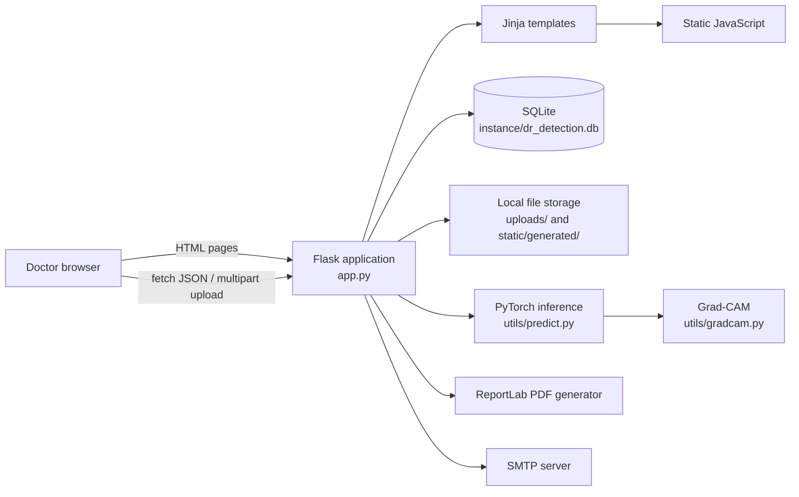
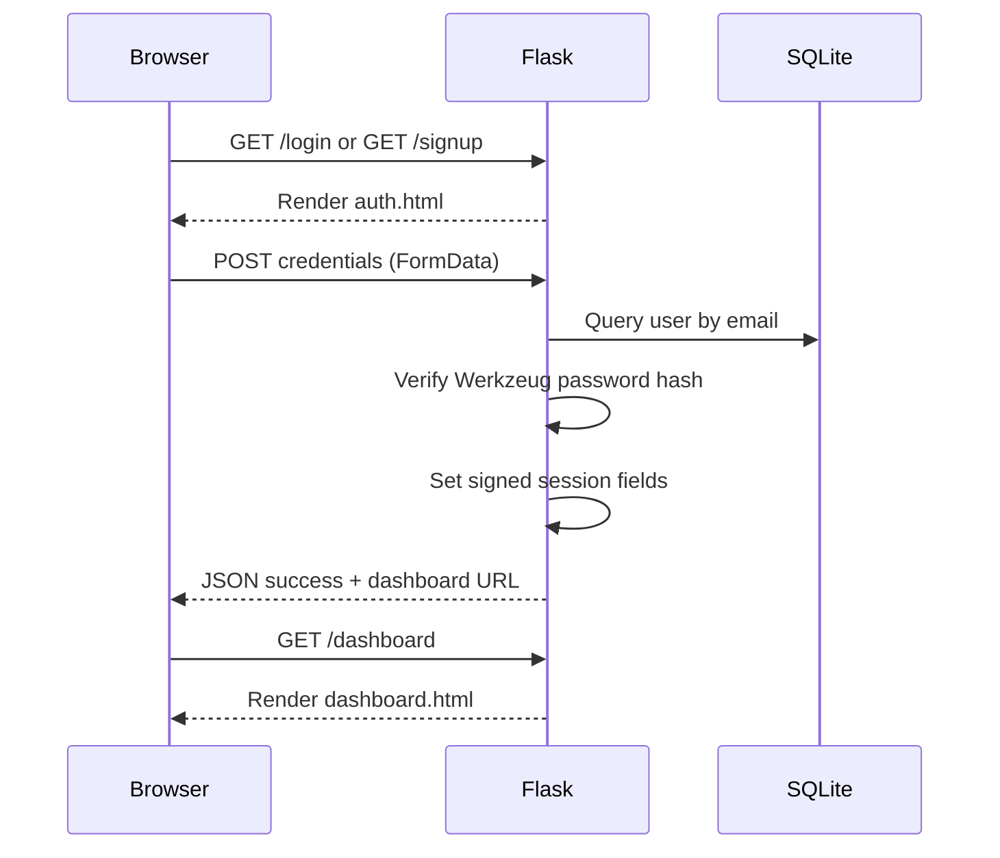
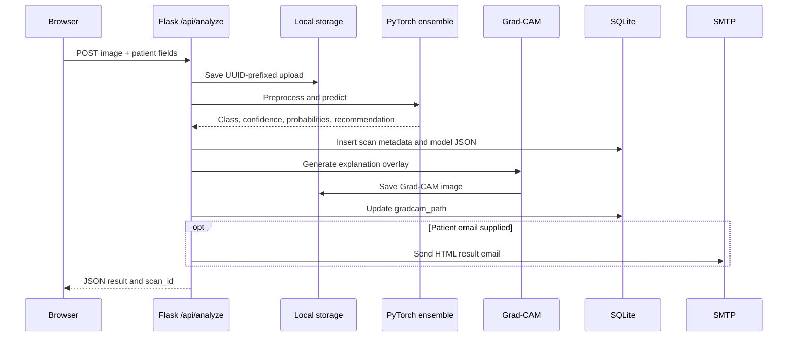
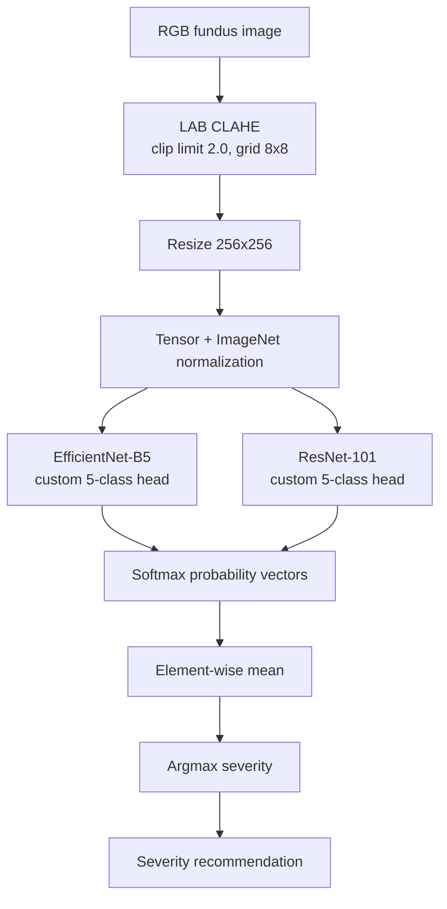

# RetinAI Architecture

## 1. System overview

RetinAI is a server-rendered Flask web application for diabetic retinopathy (DR)
screening from retinal fundus images. It combines:

- a browser-based interface for doctors and medical staff;
- Flask routes for authentication, scan management, reports, and email delivery;
- SQLite persistence for users and scan metadata;
- a PyTorch inference service using an EfficientNet-B5 and ResNet-101 ensemble;
- optional Grad-CAM explanations;
- PDF report generation with ReportLab; and
- SMTP delivery of a concise HTML result summary.

The application is intended to assist clinical decision-making. It is not an
autonomous diagnostic or treatment system.

## 2. Architectural style

The current system is a small monolithic web application:



There is no separate API service, frontend build system, task queue, model
server, or external database. Requests execute synchronously inside the Flask
process.

## 3. Repository structure

```text
g:\FYP\
├── app.py                         Flask application and route handlers
├── requirements.txt               Runtime Python dependencies
├── architecture.md                This architecture document
├── README.md                      Setup, feature, and troubleshooting guide
├── instance\
│   └── dr_detection.db            SQLite database created/updated at runtime
├── models\
│   ├── EfficientNet-B5_best.pth   EfficientNet-B5 checkpoint
│   └── ResNet101_best.pth         ResNet-101 checkpoint
├── utils\
│   ├── db.py                      SQLite connection and schema initialization
│   ├── predict.py                 Model definitions, preprocessing, inference
│   ├── gradcam.py                 Grad-CAM hooks and overlays
│   ├── report_generator.py        ReportLab PDF construction
│   └── email_service.py           SMTP HTML email delivery
├── templates\
│   ├── base.html                  Authenticated page shell/navigation
│   ├── landing.html                Public landing page
│   ├── auth.html                   Login and sign-up forms
│   ├── dashboard.html              Summary statistics and recent scans
│   ├── scan.html                   Patient form, upload, and results UI
│   ├── report.html                 Detailed scan report
│   └── history.html                Searchable scan history
├── static\
│   ├── css\                       Application styles
│   ├── js\                        Shared and scan-specific browser logic
│   ├── images\                    Static image assets
│   └── generated\                 Grad-CAM images and generated PDFs
├── uploads\                        Uploaded retinal images
├── data_folder\                    Training/validation/test data
├── *.ipynb                         Model training notebooks
├── thesis_figures\                 Training curves and confusion matrices
└── test_landing.py                 Basic landing-page smoke test
```

The repository also contains generated reports, Grad-CAM images, trained model
artifacts, and research figures. These are runtime or research assets rather
than independently deployable services.

## 4. Runtime components

### 4.1 Flask application (`app.py`)

`app.py` is the composition root and request orchestrator. It:

1. creates the Flask application and configuration;
2. initializes the database before each request;
3. manages the session-based authentication state;
4. validates and stores uploaded files;
5. calls the inference and explanation utilities;
6. persists scan results;
7. renders HTML templates or returns JSON;
8. generates downloadable PDF reports; and
9. triggers SMTP report delivery.

The upload limit is 16 MiB and accepted extensions are PNG, JPG, JPEG, TIFF,
and BMP. Uploaded names are passed through `secure_filename` and prefixed with
a UUID.

### 4.2 Web presentation layer

Jinja templates render the application pages on the server. `base.html`
provides the authenticated navigation shell, while `auth.html` is a
standalone login/sign-up view. Browser JavaScript:

- submits authentication forms asynchronously;
- implements drag-and-drop image selection and local preview;
- submits scans as `multipart/form-data`;
- renders probabilities, model cards, recommendations, and Grad-CAM results;
- sends report and delete requests; and
- provides client-side history filtering.

The frontend does not perform inference. It treats the JSON returned by
`/api/analyze` as the source of truth for results.

### 4.3 Database layer (`utils/db.py`)

`get_db()` stores a SQLite connection in Flask's request-local `g` object and
uses `sqlite3.Row` so route code can access columns by name. `init_db()` creates
the schema if necessary and applies lightweight additive compatibility changes
for fields introduced after the initial schema.

The database path is fixed relative to the project root:
`instance/dr_detection.db`.

### 4.4 Inference layer (`utils/predict.py`)

The inference module:

- selects CUDA when available, otherwise CPU;
- lazily loads model checkpoints once per process;
- reconstructs the trained EfficientNet-B5 and ResNet-101 classifier heads;
- applies CLAHE, resizes images to 256×256, converts to tensors, and applies
  ImageNet normalization;
- computes softmax probabilities for every loaded model;
- averages model probability vectors to form the ensemble result; and
- maps the winning class to a five-stage DR severity and recommendation.

The five classes are:

| Level | Class |
|---:|---|
| 0 | No DR |
| 1 | Mild DR |
| 2 | Moderate DR |
| 3 | Severe DR |
| 4 | Proliferative DR |

If no checkpoint can be loaded, the system enters deterministic demo mode. In
that mode, the result is derived from image brightness and is explicitly marked
with `demo_mode: true`. Demo mode is useful for interface demonstrations but
must not be used for clinical decisions.

### 4.5 Explainability layer (`utils/gradcam.py`)

After a real-model prediction, `generate_gradcam()`:

1. preprocesses the image using the same transform as inference;
2. attaches hooks to the final EfficientNet feature layer or ResNet layer 4;
3. backpropagates the selected class score;
4. computes the gradient-weighted activation map;
5. applies ReLU and normalization;
6. overlays the heatmap on the original image; and
7. stores a representative overlay under `static/generated/gradcam/`.

Grad-CAM failure is non-fatal to the scan request. The scan remains stored and
the response can include a `gradcam_error`.

### 4.6 Reporting layer

`utils/report_generator.py` builds an A4 PDF containing:

- physician and report metadata;
- patient information;
- the predicted severity and confidence;
- source and explanation images when available;
- class probability information; and
- clinical recommendations and an AI-assistance disclaimer.

The PDF is generated on demand by `/report/download/<scan_id>` and is written
to `static/generated/reports/report_<scan_id>.pdf`.

### 4.7 Email layer

`utils/email_service.py` creates an HTML email containing the scan result,
confidence, recommendation, scan identifier, and medical disclaimer. It uses
SMTP with the following environment variables:

| Variable | Default | Purpose |
|---|---|---|
| `SMTP_HOST` | `smtp.gmail.com` | SMTP server |
| `SMTP_PORT` | `587` | SMTP port |
| `SMTP_USER` | empty | SMTP account |
| `SMTP_PASS` | empty | SMTP password/app password |

Email is optional. The scan is persisted even when email is not configured or
delivery fails; the API reports the error to the caller.

## 5. Request and data flows

### 5.1 Authentication flow



Passwords are stored as Werkzeug-generated hashes, not plaintext. The current
session stores user ID, name, email, and role in Flask's signed cookie session.

### 5.2 Scan analysis flow



The database insert occurs before Grad-CAM and email. Consequently, an
explanation or email failure does not discard the primary prediction.

### 5.3 Report flow

Authenticated users may view an HTML report or request a PDF. Both paths query
the scan using both its ID and the current session's doctor ID, enforcing
per-user record ownership at the route level.

## 6. HTTP route contract

| Method | Path | Auth | Behavior |
|---|---|---|---|
| GET | `/` | No | Landing page; authenticated users are redirected to dashboard |
| GET/POST | `/login` | No | Render login or return login JSON |
| GET/POST | `/signup` | No | Render sign-up or create an account |
| GET | `/logout` | Session | Clear session and redirect to landing |
| GET | `/dashboard` | Yes | Render recent scans and severity statistics |
| GET | `/scan` | Yes | Render scan/upload page |
| POST | `/api/analyze` | Yes | Validate upload, infer, persist, explain, optionally email |
| GET | `/report/<scan_id>` | Yes | Render an HTML report owned by the current user |
| GET | `/report/download/<scan_id>` | Yes | Generate and download a PDF report |
| GET | `/history` | Yes | Render all scans owned by the current user |
| POST | `/api/send-report/<scan_id>` | Yes | Re-send a stored result through SMTP |
| POST | `/api/delete-scan/<scan_id>` | Yes | Delete a scan record owned by the current user |

JSON errors use HTTP 400 for invalid input, 401 for unauthenticated access,
404 for records not owned by or unavailable to the user, and 500 for inference
or email failures.

## 7. Persistence model

### 7.1 `users`

| Column | Type | Constraints / meaning |
|---|---|---|
| `id` | INTEGER | Primary key, auto-increment |
| `full_name` | TEXT | Required display name |
| `email` | TEXT | Required and unique |
| `password_hash` | TEXT | Werkzeug password hash |
| `role` | TEXT | Defaults to `doctor`; currently informational |
| `created_at` | TIMESTAMP | SQLite creation timestamp |

### 7.2 `scans`

| Column | Type | Constraints / meaning |
|---|---|---|
| `id` | INTEGER | Primary key, auto-increment |
| `doctor_id` | INTEGER | Required owner; foreign key to `users.id` |
| `patient_name` | TEXT | Required patient display name |
| `patient_email` | TEXT | Optional report recipient |
| `patient_age` | TEXT | Optional age |
| `patient_id` | TEXT | Optional/generated patient identifier |
| `patient_gender` | TEXT | Optional demographic field |
| `patient_phone` | TEXT | Optional contact field |
| `diabetes_duration` | TEXT | Optional history field |
| `medical_history` | TEXT | Optional notes |
| `eye_side` | TEXT | Right/Left selection |
| `image_path` | TEXT | Filename under `uploads/` |
| `severity_level` | INTEGER | Predicted class 0–4 |
| `severity_label` | TEXT | Human-readable class |
| `confidence` | REAL | Winning ensemble probability as a percentage |
| `model_predictions` | TEXT | JSON containing per-model results/probabilities |
| `recommendations` | TEXT | Severity-specific recommendation |
| `gradcam_path` | TEXT | Relative path under `static/`, nullable |
| `created_at` | TIMESTAMP | SQLite creation timestamp |

The initial schema creates the core fields, then `init_db()` adds newer patient
and Grad-CAM fields with `ALTER TABLE` when they are missing. This provides
backward compatibility for an existing local database, but it is not a
replacement for a versioned migration system in production.

## 8. File and artifact lifecycle

1. The browser uploads an image to `/api/analyze`.
2. The server stores it in `uploads/<uuid>_<safe-original-name>`.
3. The database stores only the generated filename.
4. Grad-CAM overlays are stored in
   `static/generated/gradcam/<scan>_<model>_gradcam.png`.
5. PDFs are generated in `static/generated/reports/report_<id>.pdf`.
6. Deleting a scan removes the database row only. The associated uploaded image,
   Grad-CAM image, and generated PDF are not currently removed automatically.

Because these directories contain patient-related data, they require access
controls, retention policies, backups, and secure hosting in a real deployment.

## 9. Machine-learning architecture



Both custom heads use dropout, a 512-unit linear layer, batch normalization,
ReLU, dropout, a 256-unit linear layer, and a final five-class linear layer.
Checkpoints are loaded lazily and moved to the selected device. The training
notebooks and `data_folder/` support model development; the web application
only consumes the saved `.pth` files.

## 10. Configuration and deployment

### Local development

```powershell
python -m venv venv
venv\Scripts\activate
pip install -r requirements.txt
python app.py
```

The development server listens on port 5000 and runs with Flask debug mode
enabled by the `__main__` block.

### Production baseline

The application can be served by a WSGI server such as Gunicorn:

```bash
gunicorn -w 4 -b 0.0.0.0:5000 app:app
```

Production deployment should set a strong `SECRET_KEY`, use HTTPS, keep model
and patient files outside public writeable paths where appropriate, and
configure a process model compatible with the memory cost of loading both
PyTorch models. Multiple workers may each load a copy of the models.

### Dependency groups

- Flask and Werkzeug: web framework, routing, sessions, password hashing.
- PyTorch and torchvision: model execution and model architectures.
- Pillow, NumPy, OpenCV: image decoding and preprocessing.
- ReportLab: PDF generation.
- Python standard library: SQLite, SMTP, JSON, UUID, and filesystem handling.

## 11. Security and privacy boundaries

Implemented protections include password hashing, parameterized SQL queries,
session checks on authenticated routes, per-user scan ownership checks,
filename sanitization, and an upload size limit.

Important hardening requirements before clinical or internet-facing deployment:

- replace the development fallback secret key with a secret environment value;
- disable Flask debug mode;
- enable HTTPS and secure, HTTP-only, appropriately scoped session cookies;
- add CSRF protection for state-changing form and fetch requests;
- validate content signatures and image dimensions, not only file extensions;
- validate and constrain patient fields and email addresses server-side;
- restrict direct access to uploaded images and generated artifacts;
- add audit logging and role-based authorization;
- configure database backups, retention, and deletion of related artifacts;
- avoid sending identifiable medical information through unencrypted email;
- protect SMTP credentials and all environment configuration; and
- treat model output and Grad-CAM as assistive, reviewable evidence.

The `role` field is stored but is not currently used to enforce different
permissions.

## 12. Failure handling and observability

The request path returns explicit JSON errors for missing/invalid uploads,
unauthorized access, failed prediction, missing scans, and email failures.
Model loading, Grad-CAM, and PDF generation currently rely primarily on
console output and exception propagation. There is no structured logging,
metrics, tracing, background job queue, or health-check endpoint.

For production, add structured application logs, request IDs, model-load
status, inference latency, storage failures, email delivery status, and a
readiness check that verifies the database and required checkpoints.

## 13. Testing and validation

The repository currently includes `test_landing.py`, a smoke test that imports
the Flask app, requests `/`, and checks the response and landing-page content.
The most important additional test boundaries are:

- sign-up, login, logout, and invalid credentials;
- unauthorized access to every protected route;
- scan ownership isolation between users;
- extension, size, malformed-image, and missing-file validation;
- demo-mode and real-checkpoint inference;
- five-class probability and recommendation contracts;
- Grad-CAM success and non-fatal failure;
- PDF creation and download;
- SMTP success and configuration failure; and
- deletion behavior, including artifact cleanup policy.

## 14. Current limitations and evolution path

The current synchronous monolith is appropriate for a final-year project,
demonstration, and small controlled deployment. It becomes harder to operate
as scan volume, users, model size, and privacy requirements increase.

Recommended evolution steps are:

1. Introduce application configuration objects for paths, limits, and secrets.
2. Move schema changes to versioned migrations.
3. Separate route handlers from service and repository modules.
4. Move images and reports to managed private object storage.
5. Queue inference, Grad-CAM, PDF creation, and email as asynchronous jobs.
6. Replace SQLite with a managed relational database for concurrent use.
7. Add explicit role-based authorization and audit trails.
8. Version model checkpoints and record model/version metadata with each scan.
9. Add automated unit, integration, and model-contract tests.
10. Add monitoring, retention automation, and clinical governance controls.

These changes preserve the current user-facing flow while making the system
more reliable, auditable, and suitable for controlled clinical environments.
